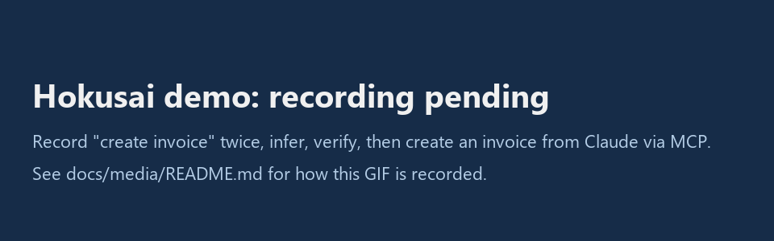
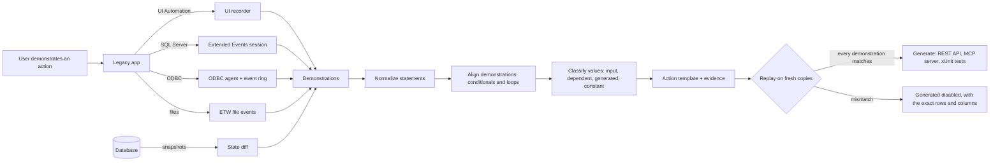

# Hokusai

**Turn an old desktop application into a verified REST API, MCP tools for AI agents, and regression tests, by
demonstrating its actions, without scraping the screen.**

[](https://github.com/ide-bloom/hokusai/actions/workflows/ci.yml)
[](https://github.com/ide-bloom/hokusai/releases)
[](LICENSE)



> The demo GIF is not recorded yet; `docs/media/README.md` describes how to record it.

Katsushika Hokusai's *Great Wave* shows the force hidden under the surface. Hokusai the tool reveals the database
work hidden under an old app's screens.

## Why Hokusai exists

Countless businesses run on VB6, Delphi and early .NET desktop apps that hold their core workflows and have no
API. Connecting them to modern systems or AI agents today means screen-scraping RPA bots that break whenever a
window moves, or a rewrite.

The underlying idea has been explored in research. In 2006, Tang et al. used the database's own logging to observe
which SQL statements a Java/JDBC application actually executed ([MASPLAS'06](https://prolangs.cs.vt.edu/rutgers/meetings/masplas06/papers/4_Tang.pdf)).
At MIT, Shen and Rinard's Konure inferred models of web applications by observing their database traffic and
regenerated them ([PLDI 2019](https://pldi19.sigplan.org/event/pldi-2019-papers-using-active-learning-to-synthesize-models-of-applications-that-access-databases),
[TOPLAS 2021](https://people.csail.mit.edu/rinard/paper/toplas21.pdf)). Nothing yet turns demonstrations in a
desktop app into a verified, data-level API.

Hokusai does. The user performs an action ("create invoice") a couple of times. Hokusai links the clicks and
keystrokes to the statements and file writes they caused, works out which values are inputs, and generates code
that performs the same database operations with new inputs: fast, testable and independent of the UI.

**The rule:** an action is marked *verified* only when replaying it on a fresh copy of the database, with each
demonstration's inputs, reproduces exactly the row changes the app made (generated values such as timestamps
excepted). Unverified actions are generated *disabled*, with the reason.

## How it works



1. **Capture.** UI Automation records what the user typed and clicked (with labels and automation IDs). Data events
   come from a server-side Extended Events session (SQL Server), the in-process ODBC agent, or row-level state diffs
   (Access, SQLite, or any source as a verification mode). File writes come from ETW with content diffs. At each
   start mark, Hokusai takes a baseline copy of the database.
2. **Infer.** Statements are normalized; demonstrations are aligned by statement shape; repeated blocks become loops
   over grid rows; statements present in only some demonstrations become conditional on the simplest separating
   input; every placeholder value is classified, with its evidence and confidence.
3. **Verify.** Each demonstration's baseline is restored into a fresh copy, the template runs with that
   demonstration's inputs in a transaction, and the resulting row changes, file content and read results are
   compared with the app's.
4. **Generate.** An ASP.NET Core minimal API, an MCP server and a regression test project, all executing the same
   parameterized statements through the runtime that verification used.

See [docs/architecture.md](docs/architecture.md).

## Install

Requirements: Windows 10/11 x64 and the .NET 10 runtime (desktop and ASP.NET Core). Optional, depending on the
source you observe: SQL Server Express LocalDB (regression tests for SQL Server sources), the ACE OLE DB provider
(Access) and the app's ODBC driver.

Download `hokusai-<version>-win-x64.zip` from [Releases](https://github.com/ide-bloom/hokusai/releases), check it
against `SHA256SUMS` (releases carry build provenance attestations: `gh attestation verify <zip> -R ide-bloom/hokusai`),
and unzip. It contains `hokusai.exe`, Hokusai Studio (`studio/HokusaiStudio.exe`) and the ODBC agents. To build
from source, see [CONTRIBUTING.md](CONTRIBUTING.md).

## Quick start

```
mkdir invoicing && cd invoicing
hokusai doctor
hokusai connect --sqlserver "Data Source=(localdb)\MSSQLLocalDB;Initial Catalog=Invoices;Integrated Security=true"
hokusai record "create invoice" -- C:\Apps\Invoices\Invoices.exe
#   press S, create an invoice in the app, press E; repeat with different values; press Q
hokusai infer "create invoice"
hokusai verify "create invoice"
hokusai generate --actions "create invoice" --out ..\invoicing-api --name Invoicing
cd ..\invoicing-api
dotnet test                                   # every demonstration, replayed through the generated API
dotnet user-secrets --project src/Invoicing.Mcp set ConnectionStrings:Hokusai "<connection string>"
claude mcp add invoicing -- dotnet run --project src/Invoicing.Mcp
```

Hokusai Studio offers the same workflow with live timelines and a review of every inference decision.

## CLI reference

| Command | Behavior |
|---|---|
| `connect --sqlserver <cs> \| --odbc <cs> [--file <db>] \| --sqlite <file> \| --access <file> [--watch <folder>]` | Configure the data source. The connection string is encrypted with DPAPI (`.hokusai/secrets.json`). `--watch` adds folders whose INI/CSV/XML/JSON files are snapshotted for file diffs. |
| `record <action> -- <exe> [args]` or `record <action> --attach <pid> [--yes]` | Start the app (or attach after confirmation) and capture demonstrations. S/E or Ctrl+Alt+F9 mark start and end; Q or Ctrl+Alt+F12 finishes. With redirected input it reads `start`, `end` and `quit` lines. `--agent`/`--no-agent` force the ODBC agent on or off; `--poll-ms` sets the UI polling interval. |
| `infer <action>` | Align the demonstrations and infer the template; prints parameters, steps, bindings and issues. |
| `verify <action> [--copy-from recorded\|<file>]` | Replay on fresh copies of each demonstration's baseline (default), or of a `.bak`, `.mdf`, `.db`, `.accdb` or `.sql` file, and compare. Exit code 1 when not verified. |
| `guard <action> [--step <n> (--where "<condition>" \| --unconditional)]` | List, or supply, the condition of a delete that state-diff capture could not see (for example `Status = 'Draft'`). Such actions stay unverified and disabled until the guard is supplied and `verify` passes. |
| `generate --actions <list> --out <dir> [--api] [--mcp] [--tests] [--name <Name>]` | Generate projects (all three when no flag is given). Unverified actions are generated disabled. |
| `schema-check` | Report actions whose tables changed since inference, naming the tables. Exit code 1 on drift. |
| `doctor [--clean]` | Check the data source, Extended Events permissions, leftover sessions (`--clean` drops them), LocalDB, ODBC drivers, the ACE provider, the ODBC agent and ETW. |
| `actions` | List recorded actions and their status. |

Every command accepts `--workspace <dir>` (default: the current directory).

## Supported capture sources

| Source | How | Notes |
|---|---|---|
| SQL Server (any client library, including OLE DB/ADO) | Extended Events session filtered to the app's client process ID and host; `sql_batch_completed` and `rpc_completed` | No change to the app. Result sets are recovered by replaying the demonstration on its baseline copy. Permissions: [docs/extended-events.md](docs/extended-events.md). |
| Any ODBC data source | `hokusai_agent32/64.dll` (Microsoft Detours) hooks the ODBC API in the app's process | Statement text, bound parameter values, fetched rows, row counts. [docs/odbc-agent.md](docs/odbc-agent.md). |
| Access (ACE) and SQLite files | Row-level state diffs before and after each demonstration | Statements are synthesized from the diff. Read actions cannot be observed this way. [docs/state-diff.md](docs/state-diff.md). |
| File writes | ETW kernel file events (elevated), snapshot comparison in watch folders otherwise | INI, CSV, XML, JSON and text content diffs; CSV exports are generated. [docs/capture.md](docs/capture.md). |

Verified with the bundled test apps: a .NET Framework 4.8 WinForms app using classic ADO on LocalDB, a WinForms app
using ODBC on SQLite, and an Access variant. Real VB6 and Delphi apps: see [docs/compatibility.md](docs/compatibility.md).

## Inference rules

Every placeholder value in a statement is classified, and every decision is recorded with its evidence and
confidence (shown by `hokusai infer` and in the Studio). In order of precedence:

- **Constant**: the same in every demonstration (unless a single-row result read earlier in the demonstration
  explains it, as when identity values coincide).
- **Input**: matches a UI value under a transform: identity, trim, upper or lower case, locale-aware numbers and
  dates, boolean encodings (`1/0`, `-1/0`, `Y/N`, `T/F`, `True/False`, …), LIKE patterns, or *empty stays NULL*;
  for line items, a grid column of the matching row.
- **Dependent**: equals a column returned by an earlier single-row result in the same demonstration (a next number,
  `SCOPE_IDENTITY()`, `last_insert_rowid()`, `@@IDENTITY`), or that value plus one (counters).
- **Lookup input**: a selected combo or grid text whose key came from the referenced table or an earlier result.
- **Generated**: timestamps within ten minutes of the demonstration, today's date, or fresh GUIDs.

Statements in only some demonstrations get the simplest single-input condition that separates them (a checkbox
first). Blocks repeated a varying number of times become loops tied to a grid's row count. Full rules:
[docs/inference.md](docs/inference.md).

## Generated projects

- **REST API** (ASP.NET Core minimal API): one `POST /actions/<action>` endpoint per action with an OpenAPI
  document; input validation (types, lengths, required fields, foreign-key existence and lookups); execution in a
  transaction with the same provider type; `?dryRun=true`; `Idempotency-Key`; API-key or Windows authentication;
  a JSON-lines audit log; a startup schema-drift check; binding to `127.0.0.1` by default. [docs/generated-api.md](docs/generated-api.md)
- **MCP server** on the official ModelContextProtocol C# SDK: one tool per action with descriptions from action names,
  UI labels and parameter metadata. Read tools run freely; write tools require `confirm: true` and support
  `dryRun`; destructive tools are annotated as such. [docs/mcp.md](docs/mcp.md)
- **Regression tests** (xUnit): each demonstration restores its baseline into a fresh copy, runs the action through
  the generated API and compares the row changes, CSV content and read results with the recording.

## Safety

- Verification always runs against copies; the configured database is only read.
- Generated APIs bind to localhost and refuse a database on another machine unless
  `Hokusai:AllowNonLocalDatabase=true`. **Use a read-only database login for read actions and a least-privilege
  login for write actions.**
- Credentials are never written in plain text: Hokusai stores them with DPAPI; generated projects read user secrets
  or environment variables.
- No telemetry and no network use beyond the configured databases.
- The ODBC agent only loads into apps you started through Hokusai or explicitly attached.

See [SECURITY.md](SECURITY.md).

## Limitations

- Logic with no data effect (printing, on-screen calculations) is out of scope and reported as such.
- Stored procedure calls are captured and replayed as calls; their internals are not analyzed.
- Calls the app makes to HTTP services are not captured (see the roadmap).
- Diff-only sources (Access, SQLite without the agent) cannot observe reads, and a delete's guarding condition
  (`AND Status = 'Draft'`) is invisible to them. Such an action is never marked verified on its own: you supply the
  condition (or confirm there is none) with `hokusai guard`, and it is enabled only after verifying with it.
- Conditions are single-input rules; loops tie to one grid; lookups resolve through a single table.
- Values computed by the app (a total it sums itself) cannot be explained unless they are inputs, results or counters.
- Each demonstration should vary every input; values identical in all demonstrations are treated as constants.
- ODBC capture of parameter arrays (`SQL_ATTR_PARAMSET_SIZE` > 1) and row-wise binding of multi-row fetches is not
  supported.

## FAQ

**Does Hokusai change my app?** No. SQL Server capture is server-side; ODBC capture loads a read-only agent into a
process you started or attached; file databases are only snapshotted.

**What if inference is wrong?** Verification catches it: the action stays disabled, and `hokusai verify` lists the
exact rows and columns that differ. Record another demonstration that varies the misread value and infer again.

**Why record twice?** With one demonstration, an input cannot be told apart from a constant.

**Can I edit the generated code?** It is plain C#, but regenerate instead of editing so it stays faithful to the
verified template.

## Roadmap

- HTTP service calls made by the app as a capture source.
- Multi-input conditions and nested loops.
- Lookups through joins.
- Stored procedure body analysis.

## Contributing, security, license

Contributions are welcome: [CONTRIBUTING.md](CONTRIBUTING.md) and [CODE_OF_CONDUCT.md](CODE_OF_CONDUCT.md).
Report vulnerabilities privately as described in [SECURITY.md](SECURITY.md).

Hokusai is licensed under the [Apache License 2.0](LICENSE). Third-party components: [THIRD_PARTY_NOTICES.md](THIRD_PARTY_NOTICES.md).
